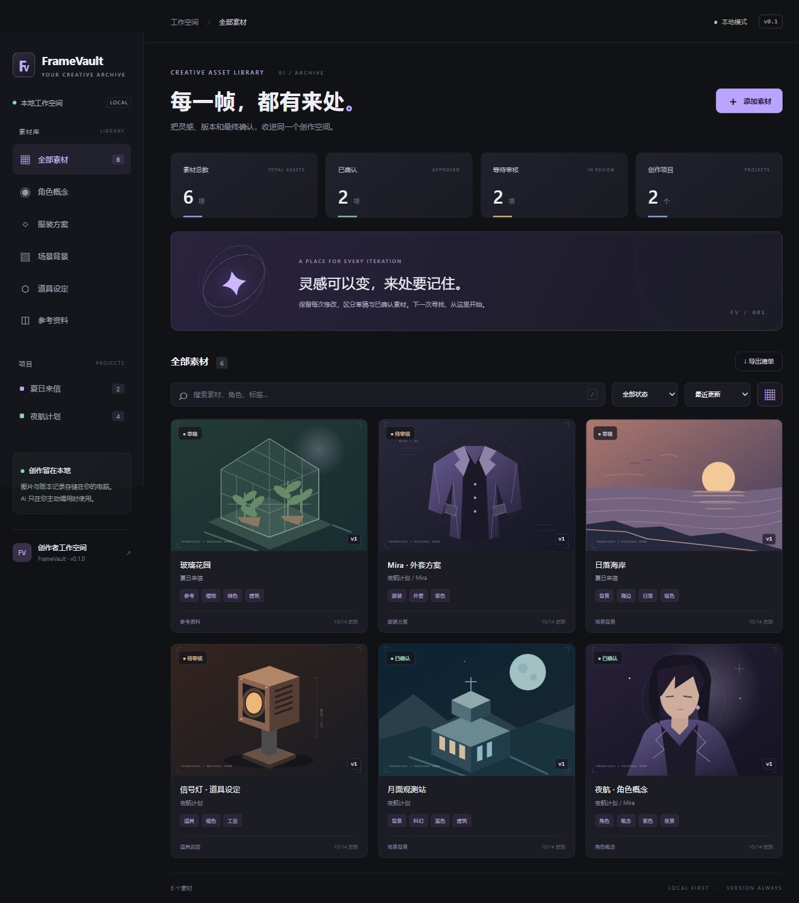

# FrameVault

**每一帧，都有来处。** A local creative asset library for game makers, illustrators and AI creators.

FrameVault keeps images, immutable file versions, searchable metadata and approval states together. Its optional vision adapter proposes tags for human review. The library works without an AI account.



## Quick start / 快速开始

Requires **Node.js 24 or later**. No npm dependencies, package installation or database service required.

```sh
git clone https://github.com/xngsgs/framevault.git
cd framevault
npm start
```

Open **http://127.0.0.1:4317**. Click **载入演示素材** to explore six original vector samples in an empty library, or **添加素材** to import your own image.

On Windows, use `npm.cmd start` if PowerShell blocks `npm.ps1`.

## What you can do

- Import PNG, JPEG and WebP images up to 10 MB. File signatures are checked, and duplicate imports are rejected by SHA-256.
- Organize assets by project, character, type, tags and notes; search Chinese or English metadata.
- Mark the latest version as draft, in review, approved or archived.
- Upload a new version without overwriting previous bytes. A new image resets the current approval to draft.
- Preview and download historical versions.
- Export a JSON manifest of the currently filtered collection, including all its versions and hashes.
- Optionally ask a vision model for tags, review the proposal, then explicitly accept it.

The interface currently uses Simplified Chinese. The project documentation is bilingual where useful.

## Optional AI configuration

Copy `.env.example` to `.env`, then configure your provider:

```dotenv
FRAMEVAULT_AI_BASE_URL=https://api.openai.com/v1
FRAMEVAULT_AI_MODEL=your-vision-model-id
FRAMEVAULT_AI_KEY=your-api-key
```

Restart the server. Import a raster image, open its details and click **分析图片**. Before sending, the interface shows the destination and asks you to confirm. Only that latest image and its title, type and existing tags are sent; character and project names, notes and previous versions are not included.

The adapter uses the Chat Completions `image_url` input and `response_format: { type: "json_object" }`. Choose a model supporting both vision and JSON mode; compatibility with other providers depends on their implementation. Endpoint configuration uses HTTPS, or HTTP for a local provider. Keys remain server-side and are excluded from Git. Calls can incur provider fees.

See the [official API reference](https://developers.openai.com/api/reference/resources/chat/subresources/completions/methods/create) for the wire format. AI results do not establish character identity, image ownership or approval.

**Validation status:** the adapter has automated contract, error and concurrency tests with a mock provider. Live paid-model quality has not been evaluated for v0.1.0.

## Local data and backups

The first start creates `data/library.sqlite` and `data/media/`. These are ignored by Git. Stop the server before copying the entire `data/` directory for a backup. Restore the complete directory with the server stopped.

JSON manifests are metadata exports, **not complete backups**: they do not include image bytes, and importing manifests is not implemented in this release. Upload file content is retained even when database insertion fails after a file write; this can leave an unreferenced file, but never overwrites an existing version.

The HTTP server binds to `127.0.0.1` and rejects untrusted hosts and cross-site requests. This is a single-user local tool. Authentication, remote hosting and team access are outside v0.1.0's supported use.

## Development and verification

```sh
npm run check
npm test
npm run dev
```

The test suite covers real temporary SQLite databases, file persistence, duplicate handling, approval resets, filtered exports, HTTP requests, origin/host protection and mocked AI proposals. No real API credentials or network calls to an AI provider are needed. GitHub Actions runs the same checks on Windows and Linux.

```text
src/          HTTP API, SQLite store, validation and AI adapter
public/       browser interface and original demo SVGs
test/         storage, API and AI contract tests
scripts/      syntax checks and reproducible demo artwork
docs/         architecture, roadmap and maintenance record
```

See [architecture](docs/architecture.md), [roadmap](docs/roadmap.md) and [contributing](CONTRIBUTING.md).

## License and authorship

Code and the original SVG demo illustrations are licensed under MIT. User-imported images retain their own rights and are not part of this repository.

The initial implementation was developed with Codex assistance. Repository history, tests and documentation describe the implementation; contributors should be able to explain the code they maintain.
