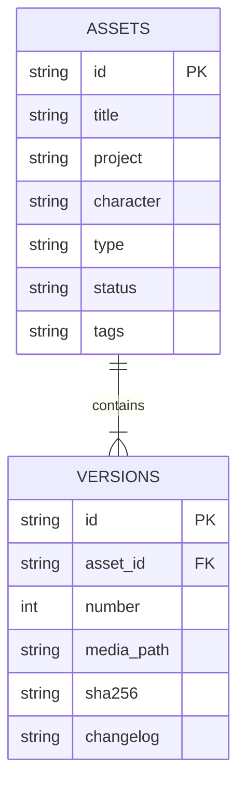

# Architecture / 架构

## Scope

A single-user library served from loopback. Node.js provides HTTP, file handling, hashing, tests and the built-in SQLite driver. The browser uses native JavaScript and CSS. No external runtime packages are required.

## Data model

`assets` contains the stable identity of a resource: project, character, type, searchable tags, notes and **the review status of its latest version**.

`versions` contains immutable source filenames, content-addressed media paths, SHA-256 hashes, sequence numbers and change notes. Viewing an older version does not change the latest version or its review state. Historical per-version approval decisions are not stored in v0.1.0.

## Import and review

1. Validate metadata, size, data URL MIME and image signature.
2. Calculate SHA-256 and reject a duplicate import.
3. Write bytes to an immutable hash-based path.
4. Create asset and version rows within a SQLite transaction.
5. Enter draft status. Review is an explicit user action.

Adding a version uses `BEGIN IMMEDIATE` and a unique `(asset_id, number)` constraint. It preserves all earlier files and resets latest status to draft. SQLite and file writes cannot participate in one shared transaction, so a database failure may leave an unreferenced file; future maintenance can add an audited garbage collection tool.

## API

| Method | Route | Behavior |
| --- | --- | --- |
| GET | `/api/health` | Version and nonsecret AI configuration status |
| GET | `/api/assets` | Filter by `q`, `project`, `type`, `status`, exact `tag` |
| GET | `/api/assets/:id` | Metadata and version history |
| POST | `/api/assets` | Import a raster image |
| PATCH | `/api/assets/:id` | Edit metadata and latest review status |
| PATCH | `/api/assets/bulk` | Atomically set project/status for 1–100 assets with expected image-version IDs |
| POST | `/api/assets/:id/versions` | Append immutable version |
| POST | `/api/assets/:id/suggest-tags` | Produce an unpersisted AI proposal |
| GET | `/api/manifest` | Download filtered metadata and version manifest |
| POST | `/api/demo` | Seed an empty library with original SVG examples |

Import payloads contain metadata, `filename` and a base64 image `data` URL. Version payloads contain `filename`, `data` and optional `changelog`. The 10 MB image cap and 15 MB request cap account for base64 expansion. Browser batches contain up to 20 files and send one request at a time; partial successes remain saved. Failed rows can be retried, successful rows are excluded, and pausing finishes the current request before stopping. Streamed multipart import is still planned for larger workloads.

Bulk editing accepts `{ ids, versions, changes }`. Only `project` and `status` are writable through this route. Within `BEGIN IMMEDIATE`, every selected asset must exist and its latest image ID must match the selection snapshot before updates start. Any failure rolls back the whole edit. This prevents confirming a newly uploaded image using an old selection; it is not a general metadata revision system. Database schema version remains 1.

`public/library.js` holds DOM-free filtering, project summaries and import queue behavior shared with the tests. `public/workbench.js` connects those rules to native dialogs and controls. `public/app.js` retains the single-image, detail, history and optional AI workflows. UI metadata is built with DOM nodes and `textContent`.

## AI boundary

Provider keys live in environment variables. The browser receives only enabled/disabled status and provider origin. Calls start only after the user confirms the destination. Proposals are validated and shown before writing; the adapter cannot approve an asset or change its identity.

Calls time out after 30 seconds. A per-asset lock and two-request global concurrency limit prevent repeated clicks from starting overlapping work. There is no automatic paid retry. Test fixtures intercept provider calls and make no real API requests.

## Security and limitations

- Bind only to loopback; validate Host and Origin to reduce cross-site and DNS rebinding risks.
- Serve only explicit frontend files, allowlisted demo SVGs and hash-named uploaded media.
- Accept only raster uploads. Demo SVGs are authored source files, not user uploads.
- Render user metadata with DOM `textContent`, not interpolated HTML.
- Send a strict self-only Content Security Policy, no CORS and no secret-bearing health fields.
- File signatures catch common MIME spoofing; a full decoder and dimension limits are not implemented.
- Local administrators and other programs running as the same user can access the files. This is not a multi-user security boundary.
- Database schema version is 1. Future migrations must preserve user data and ship with migration tests.

## Tradeoffs worth understanding

No framework or npm dependencies keeps initial setup small and reduces maintenance load. Synchronous SQLite and buffered requests are suitable for this bounded local workload; larger collections, huge uploads or collaborative hosting would need different performance and authorization designs. Search currently scans metadata in memory; benchmark representative collections before choosing FTS or vector indexing.
