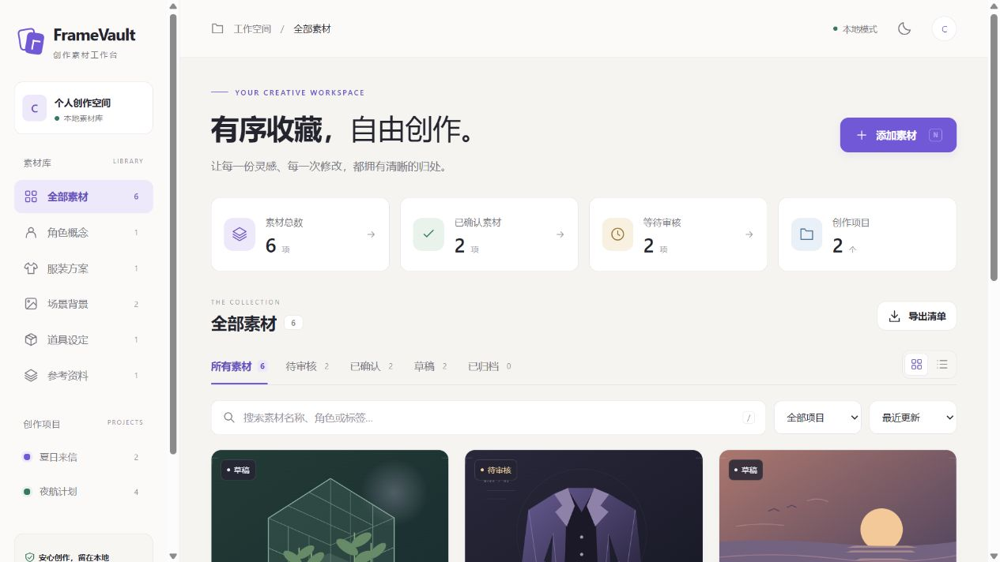
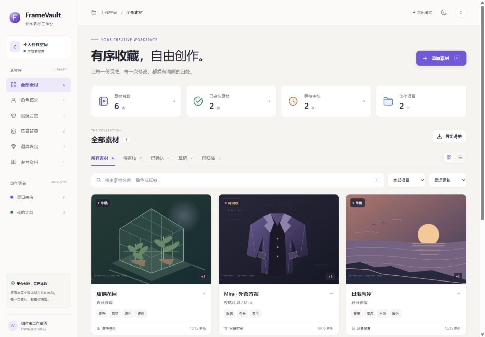
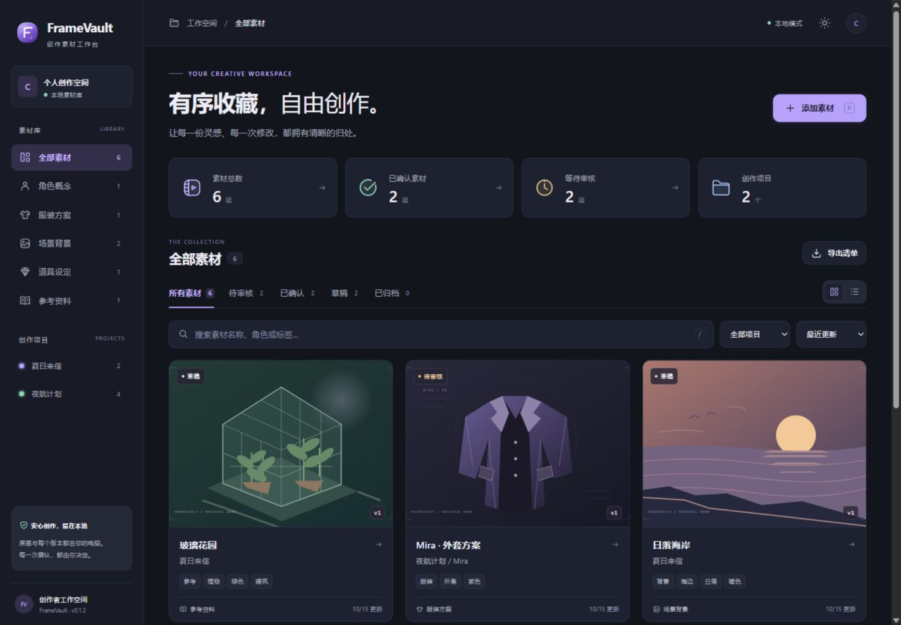
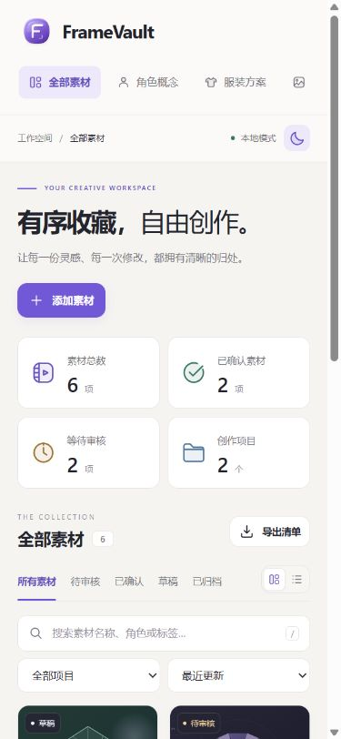
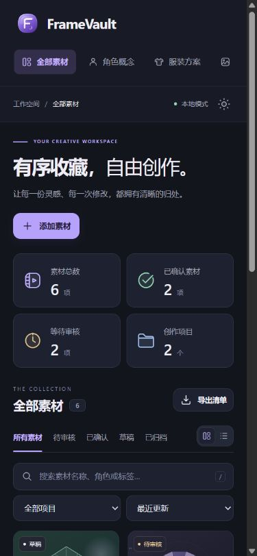

# v0.1.2 — A softer, more deliberate icon system

The previous brand mark was made from two rotated CSS rectangles. Small navigation icons and colored rectangular statistic tiles repeated that construction. This revision gives the brand a single silhouette and lets interface icons stand on their own.

## Brand

- One rounded frame with an inset F and a small viewfinder corner; no stacked cards.
- Directional violet shading, a fine rim highlight and a restrained grounding shadow create depth.
- The same standalone SVG powers the sidebar identity and browser favicon. It uses no remote fonts, images or icon service.
- The detailed brand illustration is kept separate from the small interface symbols: utility controls favor clear silhouettes and legibility.

## Interface

- Redrawn 24-unit symbols with round joins, consistent padding and a 1.65-unit default stroke.
- Light tonal fills follow `currentColor`, including light/dark themes and active navigation states.
- Larger statistics use a lighter stroke, with collection, approval, time and project illustrations instead of colored tile backgrounds.
- Prop and reference categories use a gem and an open book. Upload/download trays, zoom corners and apparel outlines have softer curves.
- Decorative SVGs are hidden from the accessibility tree; icon-only controls retain their text labels and keyboard focus treatment.
- Utility symbols remain local, inline SVGs. No dependencies or database changes were introduced.

## Review evidence

Before (v0.1.1, captured before editing):

After (1440 × 1000 CSS viewport):

Mobile (390 × 844 CSS viewport):

## Validation — 2026-10-15

- `npm run check` and all 12 existing functional tests passed locally on Windows. HTTP tests were run with localhost access enabled after the sandbox rejected loopback connections.
- Browser checks used a separate demo library, not the user's data directory.
- Verified branding loads, every rendered SVG reference resolves, icon-only controls have accessible labels, and the page has no horizontal overflow at 1440px or 390px.
- Checked light/dark switching, prop filtering, gallery/list switching, the upload dialog, mobile asset details, image enlargement and their close buttons.
- No browser errors were observed during these checks. Screenshots record appearance; they are not a claim that the user has approved the design.
- Original demo illustrations, imported image bytes and version records are unchanged. Live AI-provider behavior was not part of this visual maintenance pass.
