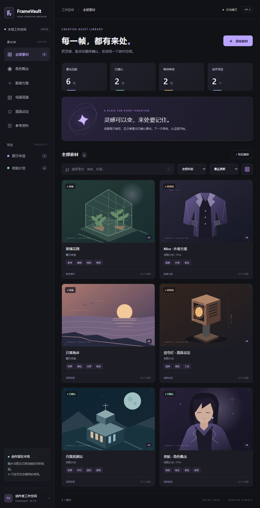
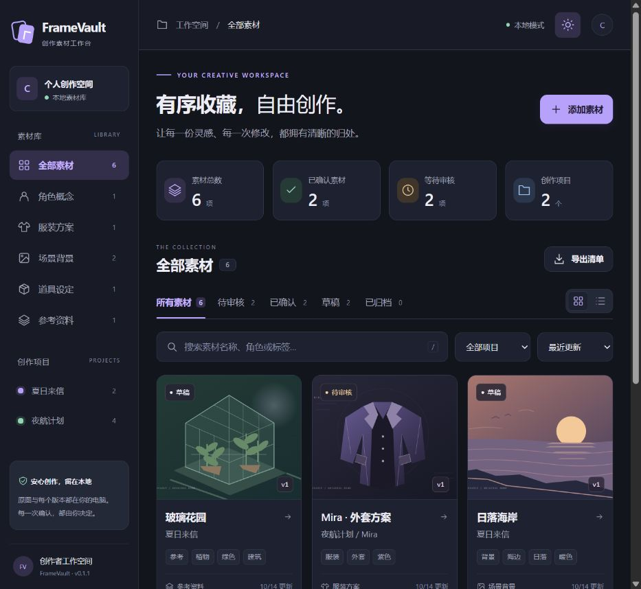
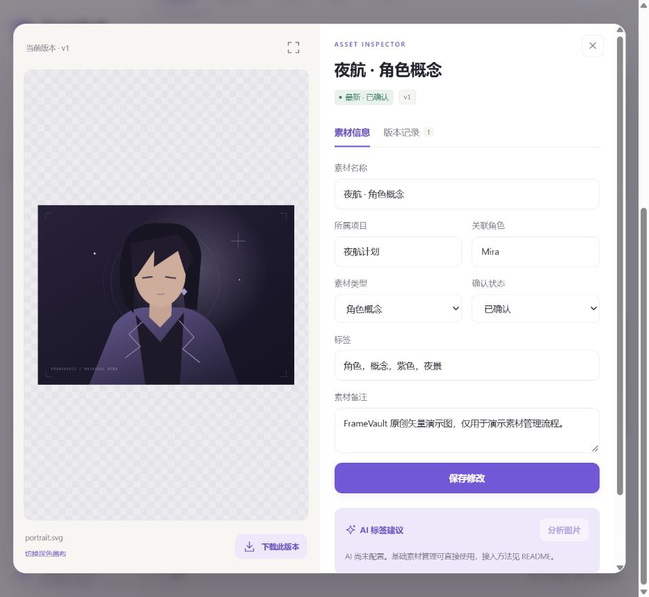

# FrameVault v0.1.1 — Studio interface

## Problem and result

The first interface used tiny labels, equally weighted panels and a large decorative banner above the actual collection. The new layout gives artwork more room, uses larger Chinese text and keeps the collection closer to the first screen.

A shared token palette supplies a warm light workspace and a graphite dark workspace. Original SVG icons, spacing, controls and status colors use one visual system. Theme and gallery/list choices are saved in browser storage; the library still works when that storage is unavailable.

## Screenshots

Before:

After, light:

After, dark:

The inspector separates editable metadata from version history and labels historical previews explicitly. Uploaded raster images are contained in their preview rather than cropped. The original generated demo SVG files remain unchanged.

## Interaction improvements

- Status tabs show counts for the current search/project/type scope.
- Project selection works from both the sidebar and a mobile-friendly dropdown.
- Active filter chips can be removed individually; empty results offer a clear reset action.
- Overview metrics link to all assets, approved assets or assets awaiting review.
- List view supports quick scanning; gallery view emphasizes artwork.
- The inspector supports keyboard tab navigation, enlarged previews and a canvas switch for checking transparency.
- Uploads show filename/size and reject unsupported types before a request; the file area also accepts a single dropped image.
- `/` and `N` shortcuts do not intercept typing, composing Chinese input or open dialogs.
- Search text is trimmed before manifest export, fixing whitespace-only differences between visible results and downloaded metadata.

## Validation

All 12 storage/API/provider contract tests passed locally. Live browser checks covered theme/layout persistence across reloads, overview shortcuts, status and project filtering, whitespace-padded search and matching exports, empty-result recovery, keyboard inspector tabs, enlarged preview, importing a raster file, saving approval, adding a second version, approval reset and historical download. The downloaded old version retained its SHA-256.

At a 390px viewport, the gallery did not overflow horizontally and the inspector fit inside the viewport. Desktop and mobile layouts were visually inspected. A synthetic test record was removed only after checking its title, project, note, tags and file hashes; the six original demo records and source images were retained.

The single-file drop interaction is implemented but was not directly exercised by native dragging in this browser QA pass. The live AI provider remains unconfigured; AI network contracts continue to use mock tests.

## Scope

No database migration, new runtime dependency or external hosting service. This change keeps the existing local API and immutable file/version model.
