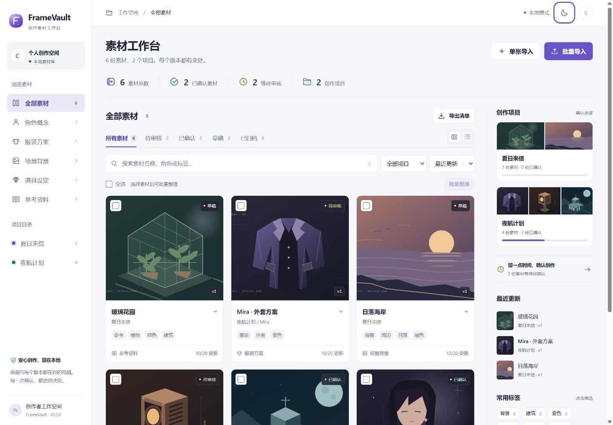
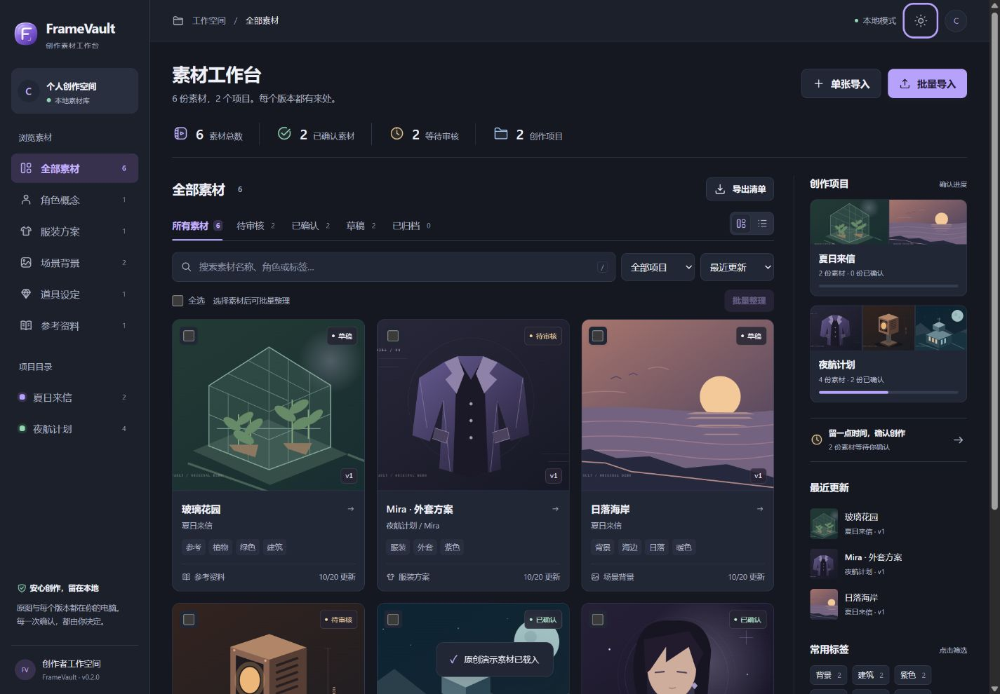
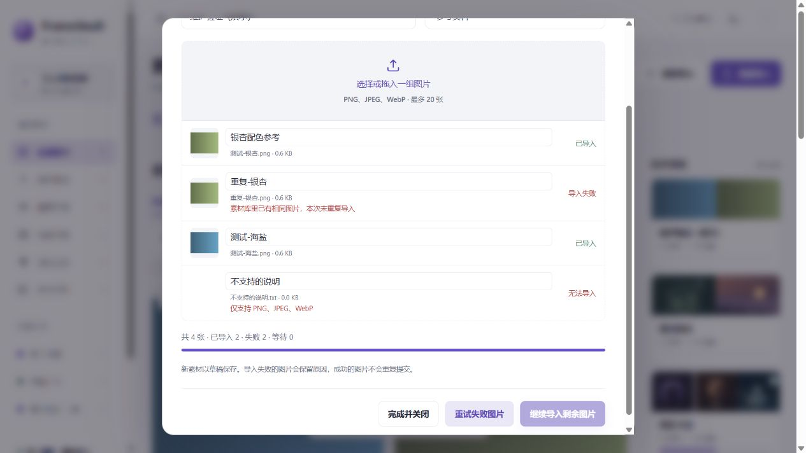
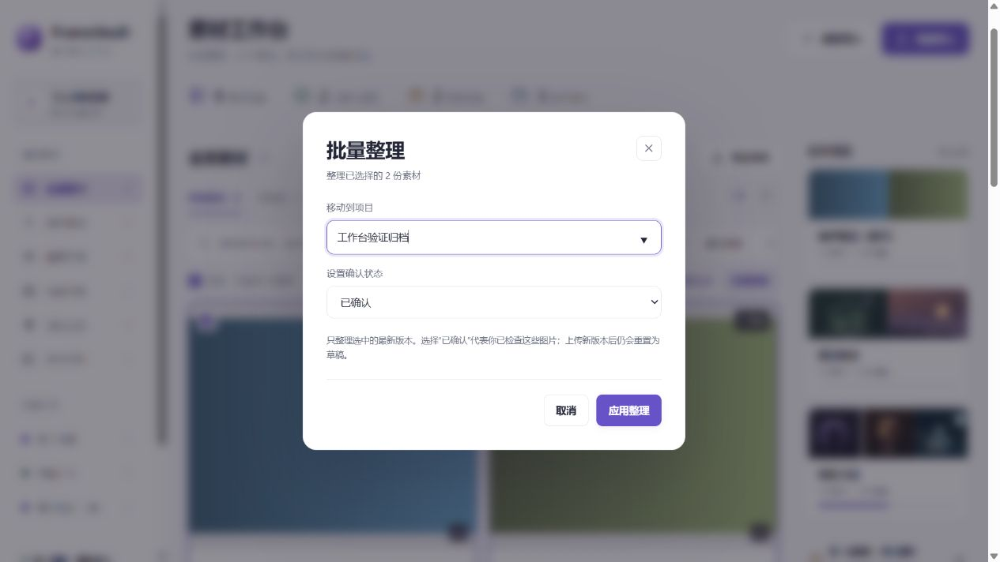
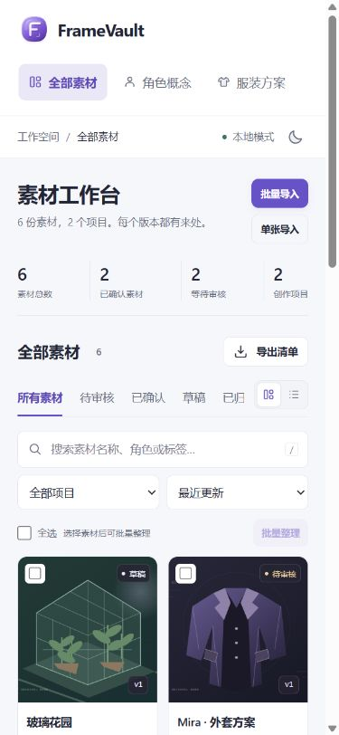

# v0.2.0 — Working with a real collection

## Design direction

FrameVault serves creators who need to find an image, organize a project and decide which version is ready. The collection should occupy the center of the screen. Project progress and review work should come from real library data.

- Palette: paper `#F6F7FB`, white `#FFFFFF`, ink `#232637`, violet `#6752C8`, mist `#EAE7F7`, sage `#39785F`. Keep the established violet brand and a corresponding dark palette.
- Type: local Segoe UI Variable for interface text, Microsoft YaHei UI/PingFang SC for Chinese. A compact 26px page title, clear 14px controls, and readable supporting text.
- Layout: left-aligned navigation, a central image contact sheet, and a narrower project/review rail on wide screens. On smaller screens, move the rail below the collection and keep controls accessible.
- Principles: images lead; spacing signals grouping; active filters are explicit; progress describes actual work. Every new action must work with the existing local library.

```text
Navigation | Workspace title / import actions
           | Compact library counts
           | Collection + search / filters | Projects / readiness
           | Image contact sheet          | Recent changes / tags
           | Selection / bulk actions     |
```

Plan review: a large greeting, four identical statistic cards and English eyebrow labels repeated the generic dashboard pattern. Replace these with a compact working header and an image-led collection. Keep the existing SVG identity; give the visual emphasis to user artwork, not additional decoration.

## Scope

- Batch import with per-image titles, progress, partial failures and failed-item retry.
- Multi-selection with explicit bulk project/status editing and atomic server validation.
- Project readiness, recent changes and exact tag filtering from actual library records.
- Preserve original files, version history, existing single-image/version import and explicit AI acceptance.

## Result

The new layout reduces the space spent on introduction and repeated statistic tiles. Project cards use actual latest-version thumbnails and confirmed/total progress. The review shortcut opens pending assets, recent items reopen details, and common tags create an exact, removable filter.

The collection uses independent open and selection controls, so keyboard users can inspect a picture or select it without nested buttons. A change of scope removes hidden assets from the selection. The sorting choice persists alongside theme and view preferences.

### Desktop

Previous design: [v0.1.2 collection](images/icons-light.png).





### Real import and organization flows

These screenshots use disposable synthetic raster files in an isolated review library.





### Mobile



## Validation — 2026-10-20

- `npm run check`, `git diff --check` and 20 tests passed locally on Windows. HTTP tests require loopback access outside the restricted sandbox.
- Tests cover atomic rollback, missing IDs, invalid fields, stale image versions, reopening schema-v1 data, exact-tag export parity, queue limits, partial failures, retry exclusion and pause/continuation. Existing media/version and mocked AI tests remain passing.
- Browser batch import selected four files: two distinct valid PNGs, one duplicate and one unsupported text file. Exactly two assets were created; retry kept the successful count at two.
- Browser bulk organization moved those two assets and explicitly confirmed them. The project reflected 2/2 confirmed. Uploading a second version reset its status to draft.
- Downloaded the first version after the second upload. Its SHA-256 matched the original fixture: `086107ac1ba179f55b079f1aeae81baa15295d4e42cfef4b63ee2792c5ab312c`.
- Clicking the purple tag returned two matching images; its downloaded manifest also contained exactly those two titles.
- Checked 1440px desktop and 390px mobile layouts without horizontal overflow, both themes, persistent list/gallery mode, selection/all-selection, scope pruning, mobile import/details/enlargement dialogs, resolvable SVG references and accessible names on empty icon buttons. No browser warnings/errors were observed in the final review.
- Tests and screenshots use separate demo libraries under the workspace tools directory. User-imported images and the user's `data/` directory were not used for public evidence.

## Boundaries

No new package or database schema is required. Follow the existing stop-and-copy backup instructions before updating a local installation. Batch pause finishes the current request; it does not roll back saved images. The screen provides per-file completion, not byte-level upload progress. New images remain drafts, and bulk confirmation is an explicit human action.

Browser interaction checks were performed during this change; a committed, repeatable browser suite and complete accessibility audit remain planned. Native drag/drop and a 20-file stress run were not separately exercised in the browser. Queue pause is covered by an automated test. Live AI quality and large-library performance were not evaluated.
